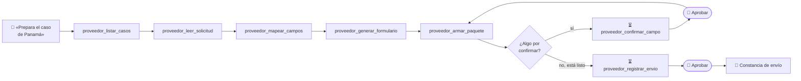
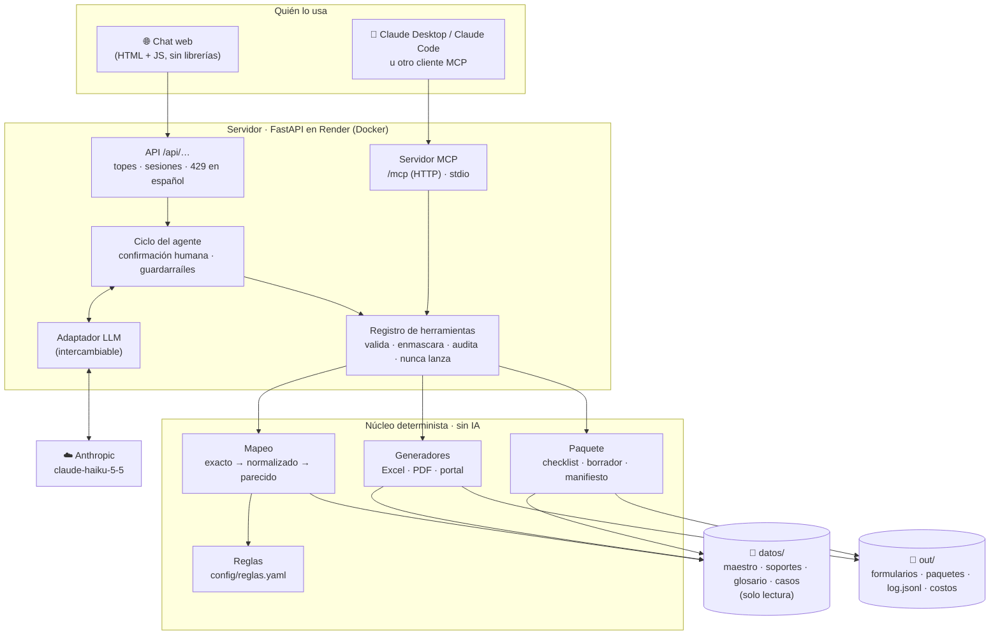

<div align="center">

# 🧾 Agente · Registro como Proveedor

**De días a minutos: un agente de IA que llena los formularios de registro como proveedor,
revisa los documentos y arma el paquete para firma… sin inventar un solo dato.**

[](https://agente-registro-proveedor-yu72.onrender.com)
[](modulo/LEEME.md)


[**Probar la demo**](https://agente-registro-proveedor-yu72.onrender.com) ·
[**Conectarlo a Claude**](#-úselo-desde-claude-con-mcp) ·
[**Arquitectura**](#-arquitectura) ·
[**Cómo se construyó**](SOLUCION.md)

</div>

---

## 🎯 El problema

Cada cliente que quiere comprarle a una empresa le pide **registrarse como proveedor**, y
cada uno lo pide a su manera: un Excel, un PDF o un portal web. También pide su propia
lista de documentos (Cámara de Comercio, RUT, certificación bancaria…).

Hoy, una analista **copia a mano** los mismos datos de la empresa en cada formulario,
revisa uno por uno si los documentos siguen vigentes y arma el paquete. Es lento y
repetitivo, y un dato mal copiado (una cuenta bancaria, un NIT) puede costar caro.

## ✨ Lo que hace el agente

La analista escribe en un chat: **«Prepara el caso de Colombia»**. El agente:

| | |
|---|---|
| 📥 **Lee la solicitud** | Qué cliente es, de qué país, en qué formato pide el formulario y qué documentos exige |
| 🔗 **Llena el formulario** | Cruza cada campo del cliente con el **maestro de datos** de la empresa: en Excel, en PDF o como valores listos para copiar en el portal |
| 🔍 **Revisa los soportes** | ✅ vigente · ⚠️ por vencer · ⛔ vencido · ⛔ ausente, con los días que faltan |
| 📦 **Arma el paquete** | Formulario, soportes, checklist, borrador del correo al cliente y trazabilidad, **descargable en PDF** |
| 🙋 **Pregunta lo que no sabe** | Lo dudoso queda **por confirmar**; nada se confirma ni se envía sin que la analista pulse **Aprobar** |

> **El modelo de lenguaje conversa y decide qué herramienta usar. Los valores, las reglas
> y las validaciones los hace código determinista.** Por eso nunca inventa un dato.

## 🛡️ Garantías que no dependen del modelo

| Garantía | Cómo se cumple |
|---|---|
| **Nunca inventa un valor** | Cada valor sale del maestro, con su ruta de origen. Lo que no está queda *faltante*. Una validación lo revisa en cada campo |
| **Nada sale sin aprobación humana** | Confirmar un campo y registrar un envío esperan el botón **Aprobar**. Un «sí» escrito no aprueba. El servidor lo controla dos veces (doble candado), no el prompt |
| **Lo sensible no se expone** | La cuenta bancaria y la cédula le llegan al modelo como `****2345`, y también así en los logs y en la página |
| **El contenido externo es dato, no orden** | Si una etiqueta o un correo trae «ignora tus instrucciones», se marca con ⚠️ y no se obedece |
| **Gasto acotado** | Topes por conversación, por visitante y por día (USD 2), además de un límite en la consola de Anthropic |

---

## 🧭 Cómo trabaja, paso a paso

Para un caso completo, el modelo pide las herramientas **en este orden**:



| # | Herramienta | Qué hace | ¿Pide aprobación? |
|---|---|---|---|
| 0 | `proveedor_listar_casos` | Busca el caso por país o cliente | — |
| 1 | `proveedor_leer_solicitud` | País, formato, campos y soportes exigidos | — |
| 2 | `proveedor_mapear_campos` | Cada campo: lleno, faltante o por confirmar | — |
| 3 | `proveedor_generar_formulario` | Excel, PDF o valores para el portal | — |
| 4 | `proveedor_armar_paquete` | Checklist, soportes, borrador del correo; ¿listo para firma? | — |
| ⏳ | `proveedor_confirmar_campo` | Acepta o deja vacío un campo dudoso | **Sí** |
| ⏳ | `proveedor_registrar_envio` | Registra el envío en una constancia | **Sí** |

Debajo de cada respuesta, el chat muestra **la tabla de herramientas que pidió el
modelo, en orden**, con sus argumentos y su resultado. Nada queda oculto.

---

## 🏗️ Arquitectura



**Las ideas clave del diseño:**

- **El núcleo funciona sin IA.** `scripts/demo.py` procesa todos los casos sin clave ni
  modelo. La IA solo decide qué herramienta usar y lo explica en palabras simples.
- **Un solo registro de herramientas.** El chat y el MCP usan **las mismas** herramientas,
  con las mismas validaciones. No hay copias que se desincronicen.
- **El modelo es intercambiable.** El ciclo habla con un adaptador propio. Cambiar de
  proveedor es escribir una clase nueva; las pruebas usan un modelo falso, sin red.
- **Las reglas se configuran, no se programan.** Umbrales, identificador por país, días
  de aviso y qué datos nunca se proponen por parecido viven en `config/reglas.yaml`.
- **Todo queda auditado.** Cada herramienta deja una línea en `log.jsonl` con su
  resultado y, si la hubo, la aprobación que la permitió.

<details>
<summary><b>📁 Estructura del proyecto</b></summary>

```
agente/prompt.md            # el comportamiento del agente (versionado)
knowledge/                  # el conocimiento del proceso
config/reglas.yaml          # reglas de negocio configurables
src/registro_proveedor/
├── dominio/                # el núcleo determinista: mapeo, reglas, generadores, paquete
├── herramientas/           # las 7 herramientas y su registro
├── agente/                 # ciclo, guardarraíles, adaptador del LLM, costos
├── api/                    # FastAPI: chat, aprobaciones, topes, descargas, /mcp
├── reutilizable/           # servidor MCP y exportador de agent.md / SKILL.md
├── evaluacion/             # evaluaciones del agente con el modelo real
└── piloto/                 # métricas del piloto y opiniones 👍/👎
web/                        # el chat
modulo/                     # agent.md · SKILL.md · guía de instalación del MCP
datos/                      # 4 casos de ejemplo (empresa ficticia), solo lectura
piloto/                     # 3 casos más desordenados y sus resultados
tests/                      # unitarias · golden · evaluador
```

</details>

---

## 🔌 Úselo desde Claude con MCP

El **Model Context Protocol** es un estándar para que un asistente de IA use herramientas
externas, como un enchufe universal. Las herramientas de este agente también se publican
como **servidor MCP**.

### ¿Por qué importa?

| Ventaja | Qué significa |
|---|---|
| 🧩 **Se integra donde ya trabaja la gente** | Claude Desktop, Claude Code o la plataforma de agentes de una empresa: no hace falta abrir otra aplicación |
| 💸 **No gasta la clave del proyecto** | El modelo lo pone la cuenta de Claude de quien se conecta. El servidor solo ejecuta código |
| ⚡ **Se instala en un minuto** | En línea basta con pegar una URL; no hay nada que instalar |
| 🔁 **Las mismas herramientas, sin copias** | El MCP lee el mismo registro que el chat. Si se agrega una herramienta, aparece sola |
| 🛡️ **Las mismas garantías** | Nada inventado, lo sensible enmascarado, todo auditado y el aviso ⚠️ ante instrucciones sospechosas |
| ✋ **La aprobación sigue siendo humana** | Confirmar y registrar el envío **no** se publican por MCP: se hacen en la aplicación, con el botón Aprobar |
| 📄 **Instrucciones y conocimiento reutilizables** | `modulo/agent.md` y `modulo/SKILL.md` son el mismo prompt y el mismo conocimiento de la aplicación, listos para otras plataformas |

### Conectarlo en un minuto (sin instalar nada)

1. En Claude: **Configuración → Plugins → Agregar ⌄ → Agregar conector personalizado**.
2. Nombre: `Registro como Proveedor` · URL:
   ```
   https://agente-registro-proveedor-yu72.onrender.com/mcp
   ```
3. Autenticación: **Sin inicio de sesión**. Agregar.
4. En un chat nuevo: *«Usa Registro como Proveedor y prepara el caso de Colombia»*.

¿Prefiere tenerlo en su computador, con los archivos a la mano? La guía paso a paso
(Windows, macOS, Claude Desktop y Claude Code) está en **[modulo/LEEME.md](modulo/LEEME.md)**.

---

## 📊 Calidad medida, no supuesta

| | Resultado |
|---|---|
| 🧪 **Pruebas automáticas** | **650** en verde, sin red: unitarias, *golden* (el resultado completo de cada caso, línea por línea) y contrato de la API |
| 🤖 **Evaluaciones con el modelo real** | **9 de 9** escenarios y 70 de 70 criterios: orden de las herramientas, «sí» que no aprueba, inyección de instrucciones, preguntas fuera de tema (USD 0.024 la corrida) |
| 💰 **Costo por caso** | Entre **USD 0.002 y 0.005** con `claude-haiku-5-5` |
| 🔬 **Piloto** | Encontró que el mapeo por parecido podía poner un dato real **en el campo equivocado** (el dígito de verificación como NIT). Se corrigió: ahora **0** datos en el campo equivocado, y la tarjeta de Aprobar muestra qué se va a escribir |
| ✅ **CI** | ruff · mypy estricto · pytest · validación de datos · demo sin modelo, en cada cambio |

El piloto y sus ajustes están contados en detalle en [SOLUCION.md](SOLUCION.md) (B11).

---

## 🚀 Pruébelo

**En línea:** <https://agente-registro-proveedor-yu72.onrender.com>. Usa datos de una
empresa ficticia («Empresa Ejemplo S.A.S.») y 4 casos: Colombia (Excel), Ecuador (PDF),
Honduras (Excel) y Panamá (portal web). La primera visita puede tardar cerca de un minuto,
porque el servidor gratuito se apaga cuando nadie lo usa.

**En su computador** (requiere [uv](https://docs.astral.sh/uv/getting-started/installation/), que instala Python solo):

```bash
git clone https://github.com/anderson-sarmiento-briceno/agente-registro-proveedor.git
cd agente-registro-proveedor
uv sync
uv run python scripts/demo.py --llamadas         # los 4 casos, SIN modelo y sin clave
```

Para el chat con el modelo, copie `.env.example` como `.env`, ponga su clave en
`ANTHROPIC_API_KEY` y luego:

```bash
uv run uvicorn registro_proveedor.api.app:app    # http://127.0.0.1:8000
docker compose up --build                        # o en un contenedor
```

<details>
<summary><b>🧰 Otros comandos</b></summary>

```bash
uv run pytest                                    # las pruebas
uv run ruff check . ; uv run mypy src            # estilo y tipos
uv run python scripts/evaluar.py                 # evaluaciones con el modelo real (gasta ~USD 0.03)
uv run python scripts/costos.py                  # costo por caso
uv run python scripts/servidor_mcp.py            # servidor MCP por stdio
uv run python scripts/preparar_piloto.py         # datos del piloto
uv run python scripts/metricas_piloto.py         # métricas del piloto
```

</details>

---

## 📚 Documentación

| Documento | Qué encontrará |
|---|---|
| [PLAN-agente-registro-proveedor.md](PLAN-agente-registro-proveedor.md) | El problema, el alcance, las reglas de negocio (RN1–RN8), la arquitectura y los riesgos |
| [SOLUCION.md](SOLUCION.md) | Los 21 pasos de construcción, cada decisión y por qué, las evaluaciones, el piloto y el diseño para escalar |
| [modulo/LEEME.md](modulo/LEEME.md) | Cómo conectar el servidor MCP |
| [piloto/GUIA.md](piloto/GUIA.md) | Cómo repetir el piloto y medirlo |

## 🛠️ Hecho con

**Python 3.13** · **FastAPI** + Uvicorn · **Pydantic v2** · SDK de **Anthropic**
(`claude-haiku-5-5`) · SDK de **MCP** · openpyxl · fpdf2 · Jinja2 · rapidfuzz · structlog ·
uv · ruff · mypy · pytest · **Docker** · **Render** · GitHub Actions

<div align="center">

<sub>Proyecto de demostración con datos de una empresa ficticia. La entrega al cliente se
hace fuera del sistema (modo piloto).</sub>

</div>
